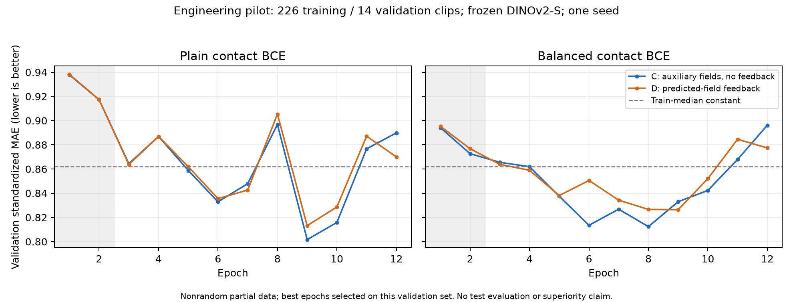

# P0 阶段反馈：数据接入与两轮工程试跑

2026-11-07。项目位于 `/mnt/afs_engine/linrui/rsi_real_test`。本阶段完成了工程试跑，**尚未完成全量数据审计或正式质量实验**。

## 目标已固定

面向无在线拟合推理：在未见交互的响应质量上接近在线仿真拟合，同时显著优于强无 bridge 对照。详情见 `TARGET_AND_STAGE_GATES_ZH.md`。质量比较必须同时报告信息输入、前处理、参数推理时间与求解器调用预算，不能用同一视频的重渲染替代新动作验证。

## 已完成的具体工作

- 真实发布 split：4,914 条，原 train 4,420 / test 494。新导入器精确检查 ID、保留原 test，只从原 train 的物体中划 val，不静默丢样。
- 真实时间：读取 run_parameters 中的 render_frame_indices 和 frame_dt，恢复相对秒数，验证长度、有限值和递增；无元数据的旧包明确回退归一化时间。
- 全量下载器：官方 HF archive 41,425,509,436 字节，断点分块、范围响应校验、最终官方 SHA256 验证。独立一次性任务已启动，下载完成后执行提取、全部五类数组的 CRC/格式/时间/标签检查，再生成正式 manifest。当前下载尚未完成，不能称“全数据已通过审计”。
- 接触损失：识别背景塌缩，增加显式 `balanced_bce` 候选，按全局 DDP 正/负区域归一化，支持无接触与空 mask。保留原 BCE 以复现首轮，不静默改变已运行实验。
- 测试：9 项契约测试通过，包括划分防泄漏、真实秒数、稀疏接触梯度、缺标签、GT 不进入推理和变长 mask。

## Kaggle 几何补齐

用户补充的 Kaggle 链接有效。当前第 4 版只有 cleaned 数据，第 2 版还包含 `3DGS_model/3DGS_model/*.ply`。已按 HTTP Range 单独提取 108 份 PLY，共 281,513,877 字节，无需重复下载仿真视频。

所有成员通过 ZIP CRC，并记录 SHA256。108 份二进制 PLY 的顶点数量、字节长度、Gaussian 字段和全部数值有限性检查通过，覆盖发布 split 统计中的全部 108 个物体，没有缺失。

这与论文的“100 个物体”描述不同；正式复现应披露发布数据事实。PLY 是 Gaussian 外观/表面资产，尚需核对内部填充、长度缩放和驱动条件，才能称为完成物理重放。

资产本地与远程项目均使用 `data/geometry/kaggle_v2/3DGS_model/3DGS_model/`，清单见 `data/metadata/kaggle_geometry_receipt.json`，数值检查见 `docs/geometry_audit.json`。

## 两轮 C/D 结果

统一设置：仅来自原 train 的 240 条非随机工程样本，其中 226 train、14 val（8 个验证物体）；原 test 全排除。冻结官方 DINOv2-S，3 视角×16 帧，12 epochs（前 2 个只监督场），单 seed，C/D 同初始化和优化预算，每组 4 张 A800，每组 684 次优化步。参数总量均 24,745,757，可训练参数均 2,687,645。每卡 PyTorch 峰值分配约 353 MB，包含 CUDA 运行时的 nvidia-smi 占用约 1.3 GiB。

| 接触损失 | C 无反馈：最佳 val 标准化 MAE | D 有反馈：最佳 val 标准化 MAE | D 相对 C |
|---|---:|---:|---:|
| 普通 BCE | 0.80168 | 0.81318 | 误差高 1.43% |
| 正负区域平衡 BCE | 0.81238 | 0.82637 | 误差高 1.72% |

训练集常数中位数基线为 0.86203。这些是 train-standardized ln1p/linear 指标，不是原论文 SPE；不与论文表格直接排名。

验证集接触正区域占比约 0.4978%。D 在普通 BCE 下的 recall 为 0.991%、precision 5.67%、IoU 0.851%；平衡后 recall 95.11%、precision 5.68%、IoU 5.66%。召回恢复，但假阳性和边界定位仍是严重问题。

逐物体配对探索区间两轮均跨零。best epoch 也在同一 val 上选择，因此即使区间不跨零，这个小规模结果也不能当作独立确认性证据。当前应作出的判断是：**工程可以训练，bridge 的材料收益尚未成立；不能声称接近在线拟合，更不能声称显著超过强无 bridge。**

原始曲线、逐参数误差和探索区间分别保存在 `pilot_v1_results.json`、`pilot_v2_balanced_results.json`。不删除任何不利结果。

## 后续执行顺序

1. 等待全量下载完成，核对官方 SHA、全量数组与原始划分；核查各本构、动作、刚度和阻尼分布。只有元数据/完整性检查，不读取模型测试分数。
2. 官方 DINOv2-g 权重已开始获取，之后先测 3×16 和 3×64 帧的真实吞吐与显存；冻结特征缓存与在线特征应先验证一致。DINOv3 仍需官方已授权权重，不能把未取得的权重列为已训练模型。
3. 在完整 train/val 上建立 RGB、仅辅助场、field feedback 和等容量 feature feedback；先单 seed 诊断，再扩展到三 seed。相同帧数、骨干和预算，不改变多个因素来掩盖失败。
4. 专门诊断：GT 场的训练集/验证集上界、打乱场语义、detach 反馈、接触定位与长尾分布。GT 场上界必须单列，不能进入部署输入。如果 GT 场也无收益，优先补原始度量场与可辨识动作；若 GT 有收益而预测场没有，优先改局部时空交互和置信度反馈。
5. 几何、尺度和边界接入统一重放。先做时间步/网格/阻尼标定，再开展新动作的无拟合、固定预算在线拟合、bridge 初始化短拟合曲线。当前还没有可报告的真实响应精度。

这两轮说明需要先确认场的信息价值和可用性。平衡监督保留为候选，尚不升级为正式默认；不会因为召回上升而宣称材参理解增强。
