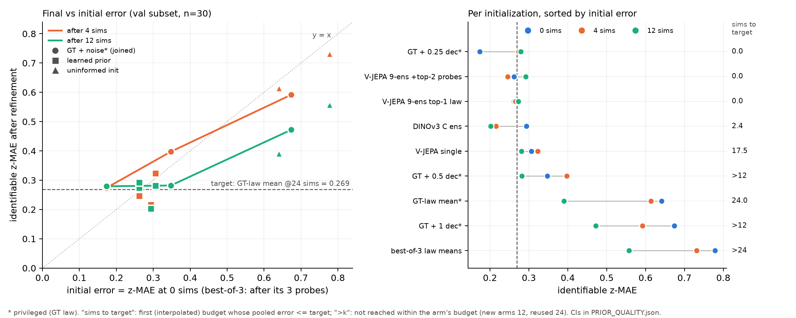

# V3h：先验质量 vs 仿真闭环精修（仅验证集）

状态：2026-11-14 19:30 UTC，全部完成。协议在运行前登记于 `docs/v3h/PROTOCOL.json`（含 30 个样本的子集、噪声抽样，以及一条 addendum）。V2 test 未使用。

审稿人可能会问：C1 的加速来自这个特定的 V-JEPA 先验，还是任何合理的初始化都可以？加速又如何随先验质量变化？

## 设置

- 精修与 V3b C1 完全相同：
  - 目标：(1−IoU) + RGB-MAE/255。
  - 优化器：compass 搜索，初始步长 0.5 decade，失败后减半。
  - 失败规则与嵌套预算的定义不变。
  - 从起始 law 出发，不做 law 探测。
  - 代码：`scripts/v3h/c1h_refine.py`，直接 import `scripts/v3b/c1_refine.py` 中的仿真、比较和编码函数。
- 子集：从 60 个 C1 val 样本中分层抽取 30 个（每个 law×动作格子 1 个，每个 law 再加 4 个），共 9 个物体，每个 law 10 个样本。这 30 个样本比 60 个整体更容易：单模型 prior 在 0 次仿真时为 0.306，60 个样本上为 0.397。
- 新臂（预算 12）：
  - dino_c：v3c_dino_C 三个 seed 的集成（均值预测 + 多数投票 law）。
  - gtnoise_σ（特权，用 GT law）：在 log10(E/ρ) 和 log10(σ_y/ρ) 的 GT 值上加噪声，σ = 0.25 / 0.5 / 1 decade。每个样本只抽一次噪声 ε，三个噪声级别共用同一个 ε 并按 σ 缩放。
- 复用臂（预算 24，从 V3b 的 state 中按完全相同的规则重算每个 k）：
  - prior（V-JEPA C s29）
  - prior_top2
  - lawmean_gt（特权）
  - lawmean_best3
- 新增 prior_top1：9-run 集成 + top-1 law，不做探测。使用 v3d test 的同一份代码（`scripts/v3d/c1_refine.py --split val`），跑全部 60 个样本，预算 24，含重放。通过 a800-2 的共享队列运行。
- 指标：可辨识 z-MAE（E/ρ、σ_y/ρ）。95% CI 由物体级 bootstrap 得到（2000 次）。
- 新增仿真数：
  - 子集新臂：1368 次，其中 109 次失败（按统一规则处理）。
  - prior_top1：1035 次，其中 87 次失败。a800-2 上的失败是确定性的 MPM 爆炸，同样的参数点在 prior_top2 中同样失败。

## 主表（30 个样本子集，可辨识 z-MAE [95% CI]）

“达到目标所需仿真次数”：目标 T = lawmean_gt 在 24 次仿真时的误差（本子集上为 0.269）。取池化曲线首次 ≤ T 的预算，按 k 线性插值；“>k”表示在该臂的预算内没有达到。

| 初始化 | 0 次 | 4 次 | 12 次 | 24 次 | 达到 T 所需次数（bootstrap 删失比例） |
|---|---|---|---|---|---|
| GT + 0.25 dec*（特权） | **0.173** [0.153, 0.194] | 0.274 | 0.279 | – | 0（4%） |
| V-JEPA 9 集成，top-1 law | 0.262 [0.222, 0.296] | 0.265 | 0.273 | 0.238 | 0（23%） |
| V-JEPA 9 集成 + top-2 探测 | 0.262 | 0.246 | 0.292 | 0.245 | 0（20%） |
| DINOv3 C 三 seed 集成 | 0.294 [0.238, 0.350] | **0.216** [0.158, 0.285] | **0.202** [0.152, 0.258] | – | 2.4（9%） |
| V-JEPA 单模型（C s29） | 0.306 [0.265, 0.348] | 0.322 | 0.281 | 0.256 | 17.5（43%） |
| GT + 0.5 dec* | 0.348 [0.307, 0.389] | 0.397 | 0.282 | – | >12（56%） |
| GT + 1 dec* | 0.674 [0.600, 0.742] | 0.592 | 0.472 | – | >12（100%） |
| GT-law 训练均值*（lawmean_gt） | 0.641 [0.532, 0.762] | 0.614 | 0.390 | 0.269 | 24（定义上） |
| best-of-3 law 均值 | 0.778（3 次探测后） | 0.731 | 0.557 | 0.466 | >24（94%） |

\* 表示特权（已知 GT law）。

- 与 lawmean_gt 同预算的配对差异（12 次）：
  - DINOv3：−0.188 [−0.279, −0.089]
  - V-JEPA 单模型：−0.109 [−0.238, 0.011]
  - GT+0.25：−0.111 [−0.165, −0.065]
  - GT+0.5：−0.108 [−0.216, −0.007]
  - GT+1：+0.082 [−0.054, 0.279]
- 线性拟合：用全部无探测臂（7 个）拟合“初始误差 → 最终误差”，4 次时斜率 0.78（r = 0.95），12 次时斜率 0.41（r = 0.88）。

## 结论（回答审稿人）

1. **不是这个特定的先验。** 在 E/ρ、σ_y/ρ 上，只要是学到的视频先验、误差相近，就能带来同样的收益。
   - DINOv3 C 集成的初始误差与 V-JEPA 单模型相当：全 val 上同为 0.406，C1 的 60 个样本上为 0.401 vs 0.397（`docs/v3h/INIT_QUALITY_VAL.json`）。
   - 精修后 DINOv3 并不更差，在子集上甚至更好：12 次时 0.202 vs 0.281。
   - V-JEPA 的优势主要体现在 9 集成上（全 val 0.351），以及 ν/ρ 和 field 指标，而不是精修本身。
   - 因此论文的说法应当是“一个学到的先验”，而不是“V-JEPA 是必需的”。
2. **加速由初始误差决定，几乎是单调的。**
   - 初始误差 ≤ 0.35 的初始化（所有学到的先验、GT+0.25/0.5）在 0–4 次仿真时就达到或接近 lawmean_gt 24 次的水平。
   - 初始误差约 0.65 的初始化（GT+1 decade、law 均值）在 12 次仿真后仍为 0.39–0.47。
   - 即使已知 GT law，加 1 decade 噪声的 GT 也与 law 均值同样差：12 次时 0.472 vs 0.390，无显著差异。可见关键是连续初值的质量，而不是知道 law。
3. **精修存在约 0.2–0.3 的地板。**
   - 原因是模型失配：hardening 固定为 0.25，ν 用预测值或均值，对应的管线复现 IoU 约 0.977。观测目标的最优点并不在 GT 上。
   - 几乎贴着 GT 的初始化（0.173）在精修后反而变差：12 次时 +0.106 [+0.023, +0.180]，47% 的样本变差。
   - 所以先验的价值在于用 0 次仿真就落到地板附近。没有先验的局部搜索在 24 次以内只能从约 0.65 降到地板，best3 甚至降不到。
   - 论文措辞建议：先验带来的是“更好的起点 + 更少的仿真”，而不是“让搜索本身更快”。

## prior_top1（9 集成 + top-1 law，不做探测），全部 60 个 val 样本

| 预算 | prior_top1 | prior_top2 | prior（单模型） | lawmean_gt* | lawmean_best3 |
|---|---|---|---|---|---|
| 0 | **0.344** [0.272, 0.404] | 0.344 | 0.397 | 0.674 | –（k=3 时 0.831） |
| 4 | 0.327 | 0.315 | 0.391 | 0.577 | 0.771 |
| 12 | 0.283 | 0.290 | 0.309 | 0.339 | 0.536 |
| 24 | **0.236** [0.159, 0.329] | 0.232 | 0.271 | 0.257 | 0.482 |

- top1 − top2 在各预算下的配对差异：
  - 4 次：+0.012 [−0.029, 0.062]
  - 12 次：−0.006 [−0.023, 0.014]
  - 24 次：+0.003 [−0.019, 0.030]
  - 结论：两者等价，而 top1 省掉了 2 次探测，在“只计搜索步数”的口径下更有利。
- top1 − 其他臂：
  - vs lawmean_best3：各预算均显著更好，例如 24 次时 −0.246 [−0.360, −0.155]。
  - vs lawmean_gt（特权）：0 次 −0.330 [−0.410, −0.236]；4 次 −0.251 [−0.386, −0.113]；12 次 −0.056 [−0.120, 0.041]；24 次 −0.021 [−0.078, 0.051]。
- law 准确率：top1 为 0.73（固定不变）；top2 探测后降为 0.62。
- 观测 IoU（4/12/24 次）：0.822 / 0.869 / 0.886（top2：0.819 / 0.877 / 0.899）。
- 重放 IoU（0/4/12/24 次）：0.690 / 0.737 / 0.778 / 0.815（top2：0.691 / 0.716 / 0.765 / 0.813）。
- lawmean_gt 追平 top1 所需仿真次数（目标 = lawmean_gt@24 = 0.257）：top1 本身在 16.8 次时达到该误差（bootstrap 删失 27%）。
- 结论：val 与 test 一致，不做探测的 top1 就是主方法应采用的形式。

## 按动作 / law 拆分（C1 的 60 个样本，z-MAE，0 / 24 次）

| 分组 | n | prior | top1 | top2 | lawmean_gt* | best3（3 / 24） | top1 − lawmean_gt，0 次 | top1 − lawmean_gt，24 次 |
|---|---|---|---|---|---|---|---|---|
| bend | 9 | 0.303 / 0.217 | 0.265 / 0.301 | 0.265 / 0.298 | 0.675 / 0.277 | 0.857 / 0.540 | −0.41 [−0.65, −0.16] | +0.02 [−0.03, 0.05] |
| drop | 9 | 0.269 / 0.221 | 0.295 / 0.173 | 0.295 / 0.151 | 0.610 / **0.090** | 0.638 / 0.276 | −0.32 [−0.56, −0.09] | **+0.08 [+0.02, +0.15]** |
| press | 11 | 0.571 / 0.533 | 0.456 / 0.422 | 0.456 / 0.463 | 0.791 / 0.331 | 1.103 / 0.793 | −0.34 [−0.43, −0.24] | +0.09 [−0.02, 0.21] |
| shear | 12 | 0.416 / 0.214 | 0.344 / 0.202 | 0.344 / 0.218 | 0.610 / 0.275 | 0.659 / 0.381 | −0.27 [−0.53, 0.01] | −0.07 [−0.28, 0.05] |
| stretch | 10 | 0.371 / 0.109 | 0.287 / 0.082 | 0.287 / 0.101 | 0.510 / 0.253 | 0.622 / 0.215 | −0.22 [−0.38, −0.03] | −0.17 [−0.53, 0.02] |
| tap30hold | 9 | 0.402 / 0.285 | 0.389 / 0.195 | 0.389 / 0.098 | 0.853 / 0.293 | 1.108 / 0.650 | −0.46 [−0.72, −0.26] | −0.10 [−0.31, 0.16] |
| jelly | 20 | 0.293 / 0.096 | 0.276 / 0.076 | 0.276 / 0.081 | 0.594 / 0.051 | 0.641 / 0.138 | −0.32 [−0.51, −0.08] | +0.02 [+0.01, +0.04] |
| metal | 20 | 0.493 / 0.371 | 0.437 / 0.330 | 0.437 / 0.291 | 0.706 / 0.253 | 0.983 / 0.661 | −0.27 [−0.44, −0.06] | +0.08 [−0.07, 0.24] |
| plasticine | 20 | 0.351 / 0.259 | 0.282 / 0.221 | 0.282 / 0.251 | 0.684 / 0.370 | 0.771 / 0.475 | −0.40 [−0.45, −0.31] | −0.15 [−0.32, 0.03] |
| 主动接触（非 drop） | 51 | 0.421 / 0.281 | 0.353 / 0.247 | 0.353 / 0.247 | 0.686 / 0.287 | 0.866 / 0.520 | −0.33 [−0.42, −0.23] | −0.04 [−0.11, 0.04] |

- 0 次仿真时，先验在每个动作、每个 law 上都大幅领先：领先 0.22–0.46，几乎所有 CI 都完全低于 0。
- 24 次仿真时，先验在主动接触类动作上仍然持平或领先：
  - 领先：stretch、tap30hold、shear、plasticine。
  - 显著落后的只有 drop（+0.08）和 jelly（+0.02，幅度很小）。在这两类上，已知 GT law 的均值初始化经过精修可以收敛到很低的误差（drop 0.090，jelly 0.051）。
- 解读：
  - drop 和 jelly 的视频信号简单，局部搜索地形平滑，特权初始化 + 足够多的仿真就能找到最优。
  - 接触类动作（尤其是 press、metal）的地形多峰，无信息搜索会停在较差的平台，因此先验更有价值。
  - press 是所有臂都最难的动作：top1 在 24 次时为 0.42，lawmean_gt 为 0.33。
- 单模型 prior 的 law 准确率在 drop 上只有 0.44，集成提高到 0.89；在 tap30hold 上分别只有 0.22 和 0.33。这是剩余误差的主要来源。

## 局限

- 子集只有 30 个样本、9 个物体，样本级方差大。lawmean_gt 的目标在 bootstrap 中删失比例较高，所以“达到目标所需次数”的 CI 很宽（上限经常删失）。
- 新臂的预算只到 12 次。GT+噪声臂只用于隔离连续初值的质量（已知 law），不是可部署的方法。
- 精修的地板来自固定的 hardening 和 ν，这是共同的模型失配。如果放开这些参数，结论可能变化。

## 文件

- 代码：`scripts/v3h/`
  - `make_protocol.py`：登记协议并生成 jobs
  - `c1h_refine.py`：精修
  - `pool.py`：a800-4 的 worker 池
  - `enqueue_top1_val.py`：共享队列的 prior_top1 jobs
  - `report.py`：汇总
  - `make_figure.py`：作图，用 `.engine-envs/plot`
  - `init_quality_val.py`：0 次仿真时各初始化的误差
- 数据：
  - `data/v3h_refine/<arm>/<idx>/state.json`
  - `data/v3b_refine/v2main_C_seed29/<idx>/prior_top1/`
- 结果：
  - `docs/v3h/PRIOR_QUALITY.json`
  - `docs/v3h/INIT_QUALITY_VAL.json`
  - `docs/v3h/prior_quality.png`
- 复现命令：`.venv/bin/python scripts/v3h/report.py && .engine-envs/plot/bin/python scripts/v3h/make_figure.py`
- 清理记录：`docs/CLEANUP_2026-11-12.md`
